# Assignment 01 — Gitea, Git Remotes, Git LFS & GitHub Pages

| | |
|---|---|
| **Name** | Mahnoor Khan |
| **Registration No.** | FA24B1-SE-012 |
| **GitHub Username** | mahnoorkhan5376 |
| **Deadline** | 10 October 2026 |

---

## Task 1: Install Gitea and Push a Repository from the Ubuntu Server

### Step 1.1: Install and Run Gitea on the Ubuntu Server
Docker, curl and the Docker Compose plug-in were installed. The instructor's Gitea repository was cloned and started with the unchanged `compose.yaml`.

```bash
cd ~/Gitea
docker compose up -d
docker compose ps
curl -sS -o /dev/null -w "Gitea HTTP status: %{http_code}\n" http://127.0.0.1:3000/
```
**Result:** `gitea` and `gitea_db` containers are running; Gitea HTTP status is 200.

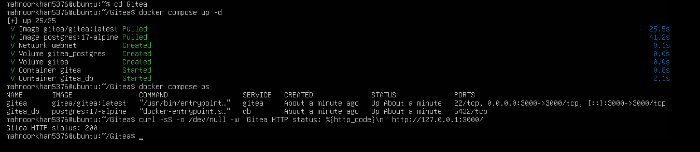

### Step 1.2: Create and Push the Initial Repository
An empty public repository `Assignment01` was created in Gitea. A separate local repository was created on the server, README.md (name and registration number) was committed, and pushed using a personal access token entered at the password prompt (token not stored in the URL).

```bash
cd ~
mkdir Assignment01 && cd Assignment01
git init
git branch -M main
git add README.md
git commit -m "Add student information"
git remote add gitea http://mahnoorkhan5376@127.0.0.1:3000/mahnoorkhan5376/Assignment01.git
git remote -v
git push -u gitea main
```
**Result:** push successful; branch `main` tracks `gitea/main`.

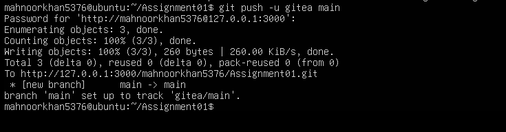

### Step 1.3: Verify the Gitea Repository
Repository owner, name, URL and the rendered README.md (name and registration number) are visible.

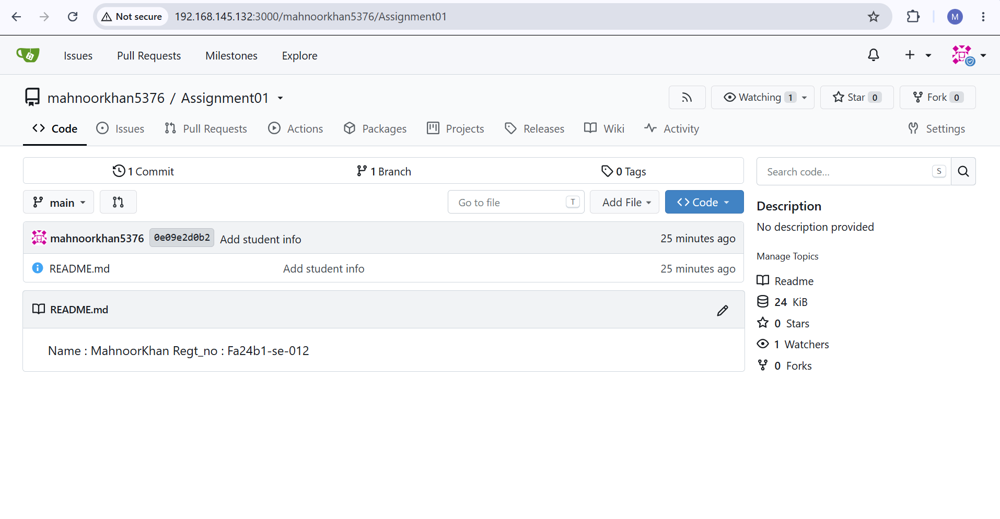

---

## Task 2: Push the Same Repository to GitHub

### Step 2.1: Create the GitHub Repository and Verify Both Remotes
```bash
cd ~/Assignment01
git remote add github https://github.com/mahnoorkhan5376/Assignment01.git
git remote -v
```
**Result:** both `gitea` and `github` remotes are listed (fetch and push); no token or password in any URL.

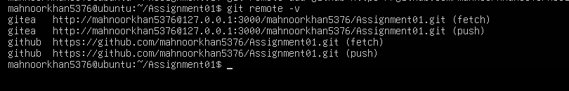

### Step 2.2: Push to GitHub
```bash
git push -u github main
```
**Result:** push successful; branch `main` tracks `github/main`.

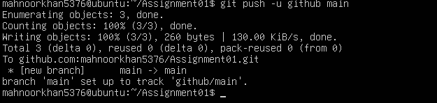

### Step 2.3: Verify the GitHub Repository
`https://github.com/mahnoorkhan5376/Assignment01` shows the owner, repository name, Public label and the rendered README.md.

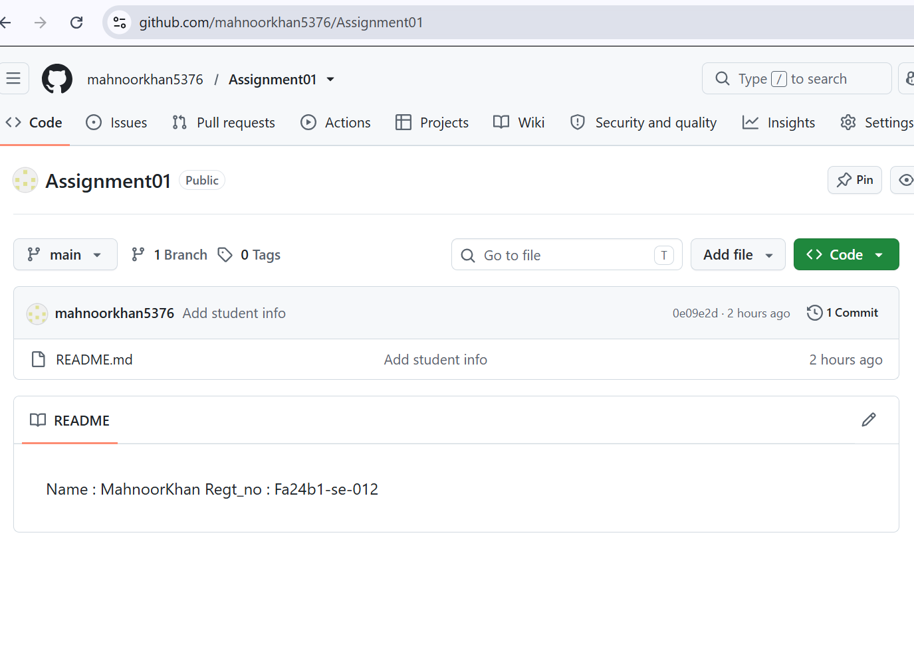

---

## Task 3: Track Three Large Files with Git LFS

### Step 3.1: Configure Git LFS
```bash
cd ~/Assignment01
git lfs install
git lfs version
git lfs track "*.bin"
cat .gitattributes
```
**Result:** Git LFS initialized (git-lfs/3.7.1); `.gitattributes` contains the `*.bin` rule.

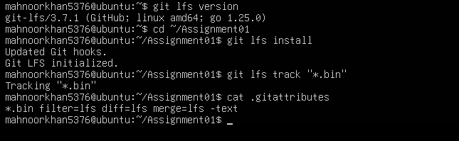

### Step 3.2: Create and Verify Three LFS Files
```bash
git add .gitattributes file1.bin file2.bin file3.bin
git lfs ls-files --size
```
**Result:** file1.bin (106 MB), file2.bin (107 MB), file3.bin (108 MB) are tracked by Git LFS.

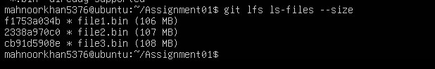

### Step 3.3: Commit and Push the LFS Files
```bash
git commit -m "Add three files using Git LFS"
git push github main
```
**Result:** LFS objects uploaded 100% (3/3), 321 MB; pushed to GitHub.

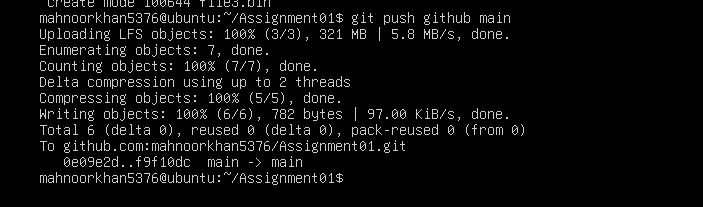

---

## Task 4: Create a Portfolio or CV with GitHub Pages

### Step 4.1: Create and Push the Portfolio Repository
Public repository `mahnoorkhan5376.github.io` contains `index.html` and the CSS file, with the sections About Me, Education, Skills and Projects.

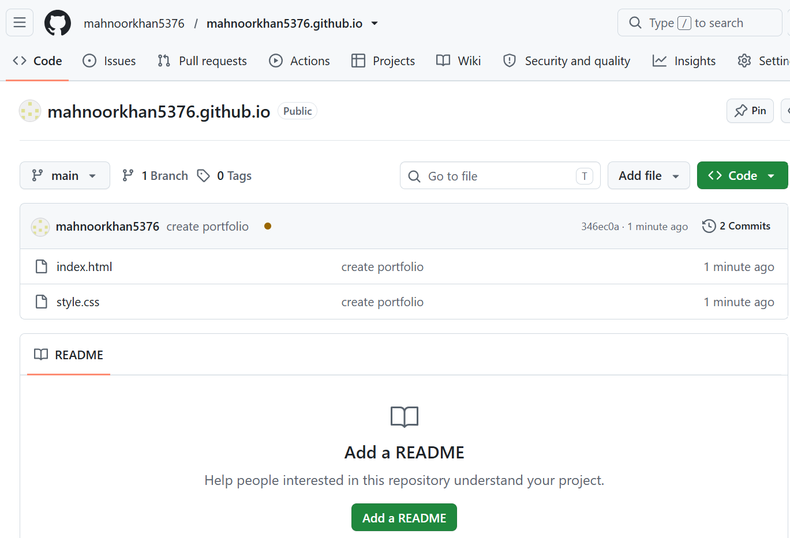

### Step 4.2: Publish with GitHub Pages
Settings → Pages → Deploy from a branch → `main` / `(root)`. GitHub reports the site is live at `https://mahnoorkhan5376.github.io/`.


### Step 4.3: Verify the Live Portfolio
The site at `https://mahnoorkhan5376.github.io/` loads successfully and shows the required sections.

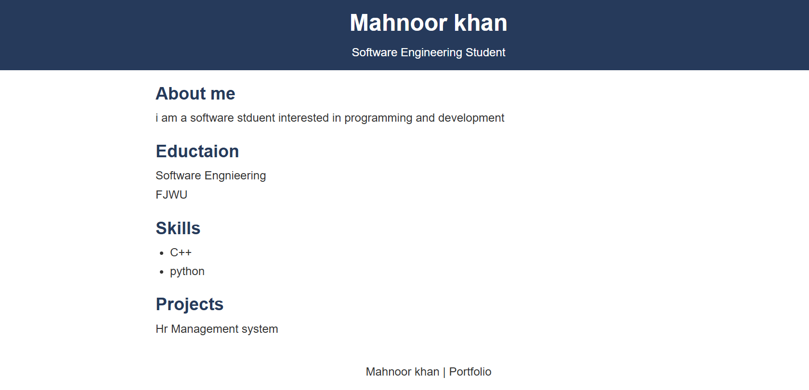

---

## Summary
- Installed and ran Gitea with PostgreSQL on the Ubuntu server using Docker Compose.
- Pushed a local repository to Gitea using a token without exposing it.
- Added GitHub as a second remote and pushed the same repository to both.
- Configured Git LFS and pushed three files larger than 100 MiB.
- Published a portfolio with GitHub Pages.
